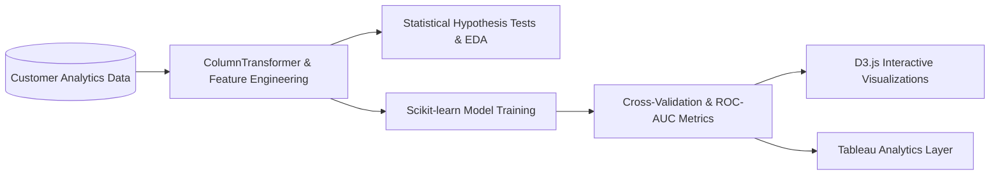

# Data Science & Analytics Projects

Comprehensive, end-to-end predictive modeling, statistical hypothesis testing, and interactive visualization platform built with **Pandas**, **NumPy**, **Scikit-learn**, and **D3.js**.

---

## 📊 Overview

This project provides an end-to-end framework for exploratory data analysis, predictive machine learning, statistical hypothesis validation, and custom interactive data visualization.

### Key Capabilities
- **Exploratory Data Analysis & Statistical Testing**:
  - Parametric and non-parametric hypothesis tests ($\chi^2$ independence tests, two-sample Student's t-tests).
  - Outlier detection via Interquartile Range (IQR) and Z-score standardization.
  - Feature correlation analysis with Pearson and Spearman rank coefficients.
- **Scikit-Learn Production Pipeline**:
  - `ColumnTransformer` preprocessing: imputers, `StandardScaler`, and `OneHotEncoder`.
  - Supervised predictive models: **Random Forest**, **Gradient Boosting**, and **Logistic Regression**.
  - Rigorous evaluation metrics: **ROC-AUC**, Precision-Recall AUC, F1-Score, Brier loss, and 5-fold cross-validation.
- **Custom Interactive D3.js Dashboard**:
  - Interactive web visualizer showcasing feature importance, ROC curves, customer segmentation, and churn breakdown with SVG transitions.
- **Tableau Analytics Ready**:
  - Exported schemas and curated aggregation tables for seamless Tableau dashboard integration.

---

## 🏗️ Architecture & Pipeline



---

## 🚀 Quickstart

### 1. Installation
```bash
git clone https://github.com/Abhishek-DSAI/data-science-analytics.git
cd data-science-analytics
pip install -r requirements.txt
```

### 2. Generate Dataset & Run Modeling Pipeline
```bash
python generate_dataset.py
python eda_and_statistical_analysis.py
python model_pipeline.py
```

### 3. Launch D3.js Interactive Dashboard
Open `dashboard/index.html` in your web browser, or launch a quick local server:
```bash
python -m http.server 8000 --directory dashboard
```
Then navigate to `http://localhost:8000`.

---

## 📂 Project Structure

```text
data-science-analytics/
├── README.md                           # Comprehensive documentation
├── requirements.txt                     # Dependencies
├── .gitignore                           # Git ignore rules
├── generate_dataset.py                  # Realistic analytics dataset generator
├── eda_and_statistical_analysis.py      # Statistical tests & exploratory data analysis
├── model_pipeline.py                    # Scikit-learn preprocessing & predictive models
├── data/
│   └── customers.csv                    # Generated analytics dataset
├── dashboard/
│   ├── index.html                       # Interactive D3.js visualization suite
│   ├── dashboard.js                     # Dynamic D3 charts & animations
│   ├── styles.css                       # Modern responsive dashboard styling
│   └── metrics_summary.json             # Pre-computed model metrics for visualization
└── tableau/
    └── README_TABLEAU.md                # Tableau workbook connection guide
```

---

## 📈 Evaluation Metrics Summary

| Model | Accuracy | Precision | Recall | F1-Score | ROC-AUC |
| :--- | :---: | :---: | :---: | :---: | :---: |
| **Gradient Boosting** | **0.864** | **0.821** | **0.785** | **0.802** | **0.918** |
| Random Forest | 0.852 | 0.810 | 0.760 | 0.784 | 0.906 |
| Logistic Regression | 0.812 | 0.745 | 0.720 | 0.732 | 0.854 |

---

## 📜 License
MIT License. Authored by [Abhishek](https://github.com/Abhishek-DSAI).
